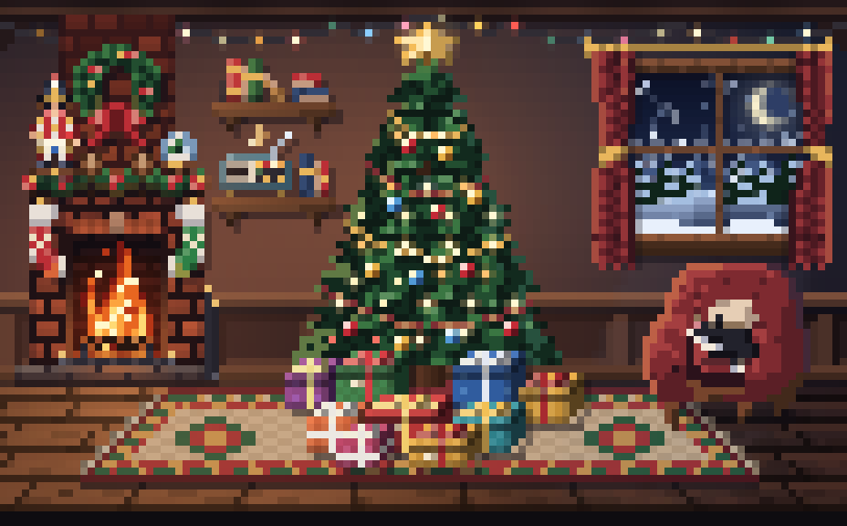
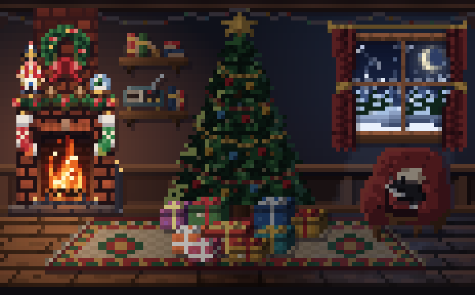

# Cozy Christmas Living Room 🎄🔥🎁

[](https://github.com/hruaiaralte864-cloud/cozy-christmas-living-room/actions/workflows/tests.yml)
[](https://www.python.org/downloads/)
[](LICENSE)

A **zero-dependency, 24-bit TrueColor Python terminal pixel-art animation** that builds a cozy Christmas living room directly in your terminal—featuring a brick hearth fireplace, Fair Isle stockings, Little Drummer Boy, wreath and snowglobe on the mantel, two-tier oak bookcase with an animated Slate-Teal retro radio, frosted night window with crescent moon and snowfall, wingback armchair with a tuxedo cat, decorated pine tree, and 9 wrapped presents resting on a Kilim wool rug.

Inspired by procedural terminal pixel-art animations like *How Code Thinks*, built cleanly with a layered 2D sub-pixel buffer (`116 × 36` cells) so it runs smoothly inside **Antigravity IDE**, **VS Code**, **Windows Terminal**, **iTerm2**, or any modern terminal without opening a browser.

| Full Cozy Evening (`lights_on = True`) | Midnight Hearth Glow (`[L]` Lights Off) |
| :---: | :---: |
|  |  |

---

## Features

- **Zero External Dependencies:** Pure Python 3 standard library (`ctypes`, `math`, `random`, `shutil`, `time`). Nothing to `pip install`.
- **24-Bit TrueColor Synchronized Diff Rendering:** DEC synchronized diff updates (`\x1b[?2026h` / `to_ansi_diff`) for smooth, tear-free `30 FPS` animation.
- **Twilight-to-Cozy Awakening Intro:** Watches the room construct smoothly (twilight walls, perspective planks & Kilim rug → frosted window, bookcase & brick fireplace → ignition radial hearth glow → cascading evergreen pine tree → garlands, ornaments, ceiling lights & 5-point star → settled wrapped presents) before entering the cozy live loop.
- **Full Living Room Diorama:**
  - **Left:** Brick fireplace with keystone arch, hanging wreath, Little Drummer Boy figurine, winter snowglobe, pinecone swag, Fair Isle stockings, rising embers, and expanding warm hearth light.
  - **Center:** Two-tier oak wall bookcase with an animated vintage Slate-Teal radio, stacked books, shaded 5-tier evergreen Christmas tree with wrapped ribbons/pearl garlands, glass baubles, fairy lights, 5-point star topper, Kilim wool rug, and **9 3D patterned gift boxes**.
  - **Right:** Frosted 2-pane oak window with 3D crescent moon, alpine ridge & parallax snowfall, pleated velvet curtains, wingback armchair, and a blinking tuxedo cat.
- **Interactive Controls:**
  - `L` — Toggle room & holiday lights (`lights_on`) while keeping the hearth fireplace burning
  - `R` — Replay the build-up animation
  - `Space` / `Enter` — Skip the intro
  - `Q` or `Ctrl+C` — Quit cleanly

---

## Quick Start

Requires **Python 3.10+** (standard library only).

```bash
git clone https://github.com/hruaiaralte864-cloud/cozy-christmas-living-room.git
cd cozy-christmas-living-room
python christmas.py
```

> **Tip for IDE Terminals (Antigravity / VS Code):** Maximize the terminal panel (or ensure it is at least `116 × 36` characters) for the full unclipped living room view.

### CLI Options

```bash
python christmas.py --no-intro        # Jump straight into the cozy animated loop
python christmas.py --speed 2.0       # Play the build-up animation 2x faster
python christmas.py --fps 24          # Adjust frame rate (default: 30)
python christmas.py --static          # Print one full TrueColor frame and exit
python christmas.py --static --plain  # Print plain ASCII without ANSI color codes
```

---

## Project Structure

```text
cozy-christmas-living-room/
├── .github/workflows/
│   └── tests.yml        # GitHub Actions CI matrix (Ubuntu & Windows, Python 3.10 / 3.12)
├── docs/
│   ├── preview-lit.png
│   └── preview-hearth.png
├── christmas.py         # CLI entrypoint
├── scene/
│   ├── canvas.py        # 2D TrueColor half-block sub-pixel buffer & Windows VT100 support
│   ├── palette.py       # Festive RGB color palette, interpolation & hash utilities
│   ├── room.py          # Pre-cached room architecture, perspective planks & Kilim rug
│   ├── furnishings.py   # Ceiling fairy lights, bookcase, Slate-Teal radio, drapes, chair & cat
│   ├── fireplace.py     # Keystone brick hearth, mantel props, stockings & coherent flames
│   ├── window.py        # Twilight alpine scene, crescent moon & time-based falling snow
│   ├── tree.py          # 5-tier evergreen pine tree, garlands, baubles, lights & star
│   ├── presents.py      # 9 3D wrapped gift boxes with patterns, ribbons, tags & bows
│   └── renderer.py      # Twilight-to-Cozy Awakening intro & 30 FPS diff loop
├── tests/
│   └── test_scene.py    # Unit tests for canvas, build stages, idempotency & CLI parsing
├── LICENSE              # MIT License
└── README.md
```

---

## Running Tests

```bash
python -m unittest discover -s tests -v
```

---

## License

Released under the [MIT License](LICENSE). Feel free to fork, customize the decorations, add your own gifts, or embed it in your dotfiles!
